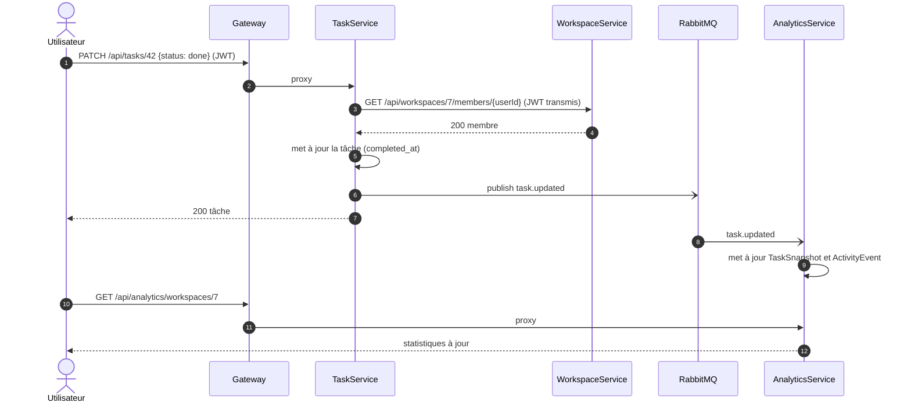
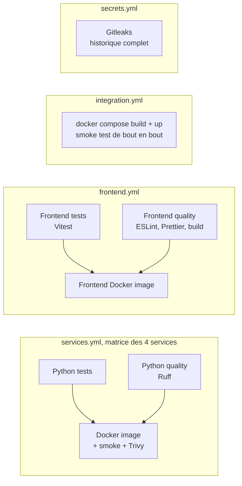

# TaskFlow

TaskFlow est une application de gestion de tâches collaborative, dans l'esprit de Trello.
Elle est construite en **microservices** : Angular 22 pour le front, FastAPI, Pydantic et
Tortoise ORM pour les services, PostgreSQL et RabbitMQ pour les données et les
événements, Docker pour le déploiement.

> Projet du cours *Intégration Cloud* (EFREI, S9). La partie DevOps s'inspire du
> [TP 01 « une CI observable et bloquante »](https://github.com/charroux/rental/blob/main/course/labs/tp01.qmd).

---

## Sommaire

1. [Architecture](#architecture)
2. [Microservices](#microservices)
3. [Démarrage rapide](#démarrage-rapide)
4. [Images Docker](#images-docker)
5. [Intégration continue](#intégration-continue)
6. [Développement local](#développement-local)
7. [Structure du dépôt](#structure-du-dépôt)
8. [Pistes d'évolution](#pistes-dévolution)

---

## Architecture


### Principes

| Sujet | Choix |
|---|---|
| **Point d'entrée unique** | Un gateway Nginx route `/api/<domaine>` vers le bon service et `/` vers le SPA Angular. Seul le port **8080** est exposé. |
| **Authentification** | UserService émet un **JWT** (HS256) contenant `sub`, `email` et `name`. Chaque service vérifie la signature avec un **secret partagé**, sans appeler UserService. |
| **Données** | Une instance PostgreSQL, **une base par service** (*database per service*). Aucune clé étrangère entre services : on ne stocke que des identifiants. Les schémas sont créés au démarrage par Tortoise (`generate_schemas`). |
| **Communication synchrone** | REST avec `httpx`. Le JWT de l'utilisateur est **transmis** à l'appel, et le service appelé applique ses propres règles d'accès. |
| **Communication asynchrone** | RabbitMQ, exchange `topic` durable `taskflow.events`, messages persistants. Une panne du broker ne fait pas échouer la requête HTTP : l'erreur est journalisée. |
| **Lecture analytique** | AnalyticsService construit sa propre **projection**, dans un style CQRS, à partir des événements. Il ne lit jamais la base de TaskService. |

### Flux d'événements



| Événement | Publié par | Consommé par | Effet |
|---|---|---|---|
| `workspace.created` / `updated` / `member_added` / `member_removed` | WorkspaceService | AnalyticsService | Journal d'activité |
| `workspace.deleted` | WorkspaceService | TaskService, AnalyticsService | Suppression des tâches et des statistiques de l'espace |
| `task.created` / `task.updated` | TaskService | AnalyticsService | Mise à jour de la projection |
| `task.deleted` | TaskService | AnalyticsService | Retrait de la projection |

---

## Microservices

Chaque service suit la même organisation : `app/main.py`, `config.py`, `models.py`
(Tortoise), `schemas.py` (Pydantic), `routers.py` et `security.py` (JWT). La
documentation OpenAPI est disponible via le gateway, à l'adresse `/api/<domaine>/docs`.

### UserService · [`services/user-service`](services/user-service)

| Méthode | Route | Description |
|---|---|---|
| POST | `/api/auth/register` | Inscription (mot de passe haché en PBKDF2-SHA256) |
| POST | `/api/auth/login` | Connexion, renvoie un JWT |
| GET / PATCH | `/api/users/me` | Profil de l'utilisateur connecté |
| GET | `/api/users/lookup?email=` | Recherche par email (utilisée par WorkspaceService) |
| GET | `/api/users/{id}` | Détail d'un utilisateur |

Docs : http://localhost:8080/api/users/docs

### WorkspaceService · [`services/workspace-service`](services/workspace-service)

Gère les espaces de travail et leurs membres. Trois rôles existent : `owner`, `admin` et `member`.

| Méthode | Route | Rôle requis |
|---|---|---|
| POST / GET | `/api/workspaces` | Être connecté (le créateur devient `owner`) |
| GET | `/api/workspaces/{id}` | Membre |
| PATCH | `/api/workspaces/{id}` | `owner` ou `admin` |
| DELETE | `/api/workspaces/{id}` | `owner` (publie `workspace.deleted`) |
| GET | `/api/workspaces/{id}/members` | Membre |
| POST | `/api/workspaces/{id}/members` | `owner` ou `admin` (appelle UserService en REST) |
| GET | `/api/workspaces/{id}/members/{userId}` | Membre (contrôle utilisé par les autres services) |
| DELETE | `/api/workspaces/{id}/members/{userId}` | `owner` ou `admin`. Un membre peut aussi se retirer lui-même. |

Un utilisateur qui n'est pas membre reçoit une **404**, pas une 403, pour qu'il ne puisse
pas deviner quels identifiants d'espace existent.

### TaskService · [`services/task-service`](services/task-service)

Une tâche a les champs suivants : `title`, `description`, `status` (`todo`,
`in_progress` ou `done`), `priority` (`low`, `medium` ou `high`), `assignee_id`,
`due_date` et `completed_at`, ce dernier étant renseigné automatiquement.

| Méthode | Route | Description |
|---|---|---|
| POST | `/api/tasks` | Création. L'auteur et la personne assignée doivent être membres de l'espace. |
| GET | `/api/tasks?workspace_id=&status=&priority=&assignee_id=` | Liste filtrée |
| GET | `/api/tasks/mine` | Tâches assignées à l'utilisateur connecté, tous espaces confondus |
| GET / PATCH / DELETE | `/api/tasks/{id}` | Mise à jour partielle : envoyer `null` vide le champ |

### AnalyticsService · [`services/analytics-service`](services/analytics-service)

| Méthode | Route | Description |
|---|---|---|
| GET | `/api/analytics/workspaces/{id}` | Total, répartition par statut et par priorité, taux de complétion, retards, tâches terminées sur 7 jours, charge par personne, activité récente |
| GET | `/api/analytics/me` | Statistiques personnelles |

### Frontend · [`frontend`](frontend)

Angular 22 (composants standalone, signals, zoneless, nouveau control flow) avec
Angular Material 3. Il comprend :

- la connexion et l'inscription ;
- la liste des espaces ;
- un **tableau kanban** avec glisser-déposer (CDK) ;
- la gestion des membres ;
- un onglet de statistiques ;
- une page « Mes tâches ».

Le JWT est ajouté automatiquement par un intercepteur, qui déconnecte l'utilisateur en
cas de réponse 401.

---

## Démarrage rapide

Il faut **Docker Desktop**, et c'est tout : aucun Node.js ni Python n'est nécessaire pour lancer l'application.

```bash
cp .env.example .env              # facultatif : des valeurs par défaut existent
docker compose up -d --build --wait
```

| URL | Contenu |
|---|---|
| http://localhost:8080 | Application TaskFlow |
| http://localhost:8080/api/tasks/docs | Swagger d'un service (même chemin pour `users`, `workspaces` et `analytics`) |
| http://localhost:15672 | Console RabbitMQ (`taskflow` / `taskflow`) |

Pour vérifier le fonctionnement de bout en bout, puis arrêter la stack :

```bash
python scripts/taskflow.py smoke   # scénario complet via le gateway
docker compose down                # ajouter -v pour effacer les données
```

Le smoke test parcourt tout le scénario :

1. inscription et connexion ;
2. création d'un espace ;
3. ajout d'un membre (REST de WorkspaceService vers UserService) ;
4. création d'une tâche (REST de TaskService vers WorkspaceService) ;
5. passage de la tâche à `done` ;
6. statistiques mises à jour via RabbitMQ ;
7. suppression de l'espace, avec purge des tâches via RabbitMQ.

---

## Images Docker

Le projet produit **6 images**, toutes construites par `docker compose build` et par la CI.

| Image | Base | Taille | Particularités |
|---|---|---|---|
| `taskflow/user-service` | `python:3.12-slim` | ~286 Mo | multi-stage (venv), utilisateur non-root, `HEALTHCHECK` |
| `taskflow/workspace-service` | `python:3.12-slim` | ~294 Mo | idem |
| `taskflow/task-service` | `python:3.12-slim` | ~294 Mo | idem |
| `taskflow/analytics-service` | `python:3.12-slim` | ~294 Mo | idem |
| `taskflow/frontend` | `node:24-alpine` pour le build, `nginx-unprivileged` à l'exécution | ~83 Mo | build Angular de production, fallback SPA, cache long sur les fichiers hashés |
| `taskflow/gateway` | `nginx-unprivileged:1.29-alpine` | ~82 Mo | reverse proxy, en-tête `X-Request-ID` |

Bonnes pratiques appliquées :

- **Builds multi-stage** : les outils de build ne se retrouvent pas dans l'image finale.
- **Exécution non-root** : utilisateur `app` pour les images Python, images Nginx *unprivileged* écoutant sur le port 8080.
- **Cache de couches** : les dépendances (`requirements.txt`, `package-lock.json`) sont copiées avant le code source.
- **Contexte minimal** : un `.dockerignore` par image (sans tests, caches ni `node_modules`).
- **Supervision** : `HEALTHCHECK` dans chaque image, et `depends_on: condition: service_healthy` dans Compose.
- **Configuration** : uniquement par variables d'environnement (12-factor). Aucun secret n'est inclus dans les images.
- **Versionnement** : la variable `TAG` fixe le tag des images (`TAG=1.0.0 docker compose build`).

---

## Intégration continue

Quatre workflows GitHub Actions, dans [`.github/workflows`](.github/workflows), appliquent
les principes du TP 01. Les images sont **construites mais jamais publiées**.



| Exigence du TP | Mise en œuvre |
|---|---|
| Tests et qualité séparés | Des jobs `tests` et `quality` distincts pour chaque service et pour le front |
| Graphe de dépendances | Le job `image` dépend (`needs`) de `tests` et de `quality` |
| Rapports exploitables même en cas d'échec | JUnit (pytest, Vitest, Ruff), couverture et scan Trivy publiés avec `upload-artifact`, `if: always()` et `retention-days: 7` |
| Annotations | `ruff check --output-format=github` |
| Sécurité de la CI | `permissions: contents: read`, actions tierces épinglées par **SHA**, aucune publication d'image |
| Coût maîtrisé | `timeout-minutes` sur chaque job, cache pip, npm et Docker (`type=gha`), `concurrency` avec `cancel-in-progress` |
| Détection de secrets | Gitleaks sur l'historique complet (`fetch-depth: 0`), avec une allowlist documentée dans [`.gitleaks.toml`](.gitleaks.toml) |
| Reproduction en local | `python scripts/taskflow.py verify` |

Les workflows n'ont **pas de filtre `paths`**. Un tel filtre empêcherait les checks
obligatoires de s'exécuter sur certaines PR, qui resteraient alors bloquées en attente.

**Checks à rendre obligatoires** sur `main` une fois le dépôt publié :

- `Python tests (*)`, `Python quality (*)` et `Docker image (*)`
- `Frontend tests`, `Frontend quality` et `Frontend Docker image`
- `Docker Compose stack`
- `Secret detection`

---

## Développement local

```bash
python -m venv .venv
.venv\Scripts\activate                  # Windows (source .venv/bin/activate sous Linux/macOS)
pip install -r services/task-service/requirements-dev.txt   # mêmes versions pour tous les services

python scripts/taskflow.py verify       # tests puis qualité ; s'arrête au premier échec (code 1)
python scripts/taskflow.py test         # pytest pour les 4 services, puis Vitest
python scripts/taskflow.py lint         # Ruff, puis ESLint et Prettier
python scripts/taskflow.py images       # construit les 6 images
python scripts/taskflow.py up | down | smoke
```

- Les tests Python utilisent **SQLite en mémoire**. Les appels REST et RabbitMQ sont
  remplacés par des faux via `dependency_overrides`, ce qui évite toute infrastructure.
- Les commandes du **front** s'exécutent dans un conteneur `node:24-alpine`, car
  Angular 22 demande Node ≥ 22.22. Il n'y a donc rien à installer.
- Pour développer le front en *hot reload* :
  1. démarrez la stack ;
  2. dans `frontend/`, lancez `npm start` (avec Node 24) ;
  3. le fichier `proxy.conf.json` redirige `/api` vers le gateway.

### Variables d'environnement

| Variable | Services | Défaut |
|---|---|---|
| `DATABASE_URL` | tous | `sqlite://:memory:` (Compose : `postgres://…/<service>_db`) |
| `JWT_SECRET` | tous (32 caractères minimum) | valeur de développement |
| `RABBITMQ_URL` | workspace, task, analytics | non défini, ce qui désactive les événements |
| `USER_SERVICE_URL` | workspace | `http://user-service:8000` |
| `WORKSPACE_SERVICE_URL` | task, analytics | `http://workspace-service:8000` |

---

## Structure du dépôt

```
taskFlow/
├── services/
│   ├── user-service/          # app/, tests/, Dockerfile, requirements*.txt, pyproject.toml
│   ├── workspace-service/
│   ├── task-service/
│   └── analytics-service/
├── frontend/                  # Angular 22 + Material, Dockerfile, nginx.conf
├── gateway/                   # Nginx API gateway, Dockerfile
├── infra/postgres/            # script de création des bases
├── scripts/taskflow.py        # verify / images / up / down / smoke
├── .github/workflows/         # services, frontend, integration, secrets
├── docker-compose.yml
└── .env.example
```

---

## Pistes d'évolution

- **Kubernetes** (TP suivants) : un Deployment et un Service par image, et un Ingress
  pour remplacer le gateway Nginx. Les healthchecks deviennent des *probes*
  `liveness` et `readiness` sur `/health`.
- **Migrations** : remplacer `generate_schemas` par Aerich.
- **Publication des images** sur GHCR depuis `main` uniquement (jamais depuis une PR),
  avec signature et SBOM.
- **Bibliothèque partagée** : `security.py` et `messaging.py` sont copiés à l'identique
  dans chaque service pour garder les images indépendantes. On pourrait en faire un
  paquet interne.
- **Fiabilité** : un *outbox pattern* garantirait la publication des événements.
