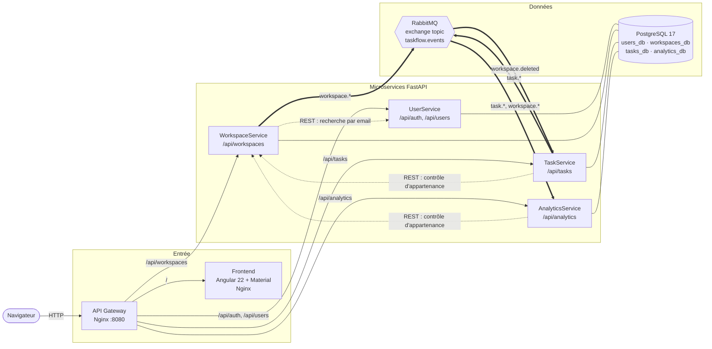
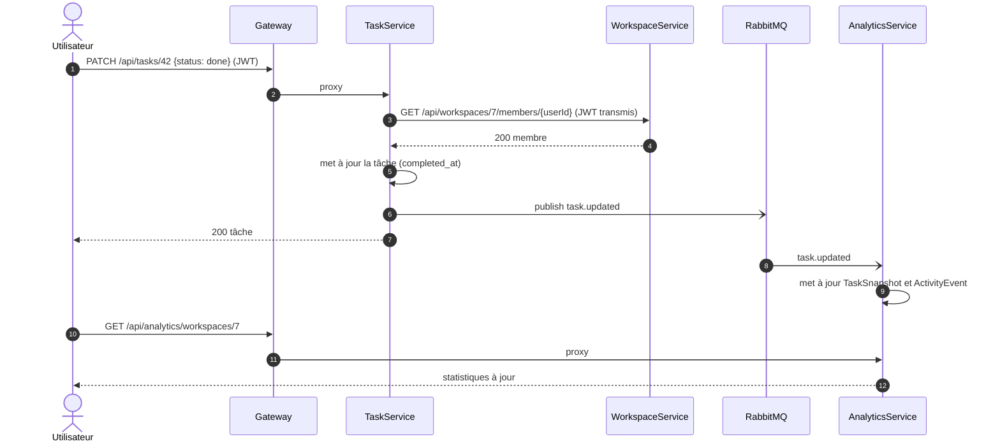
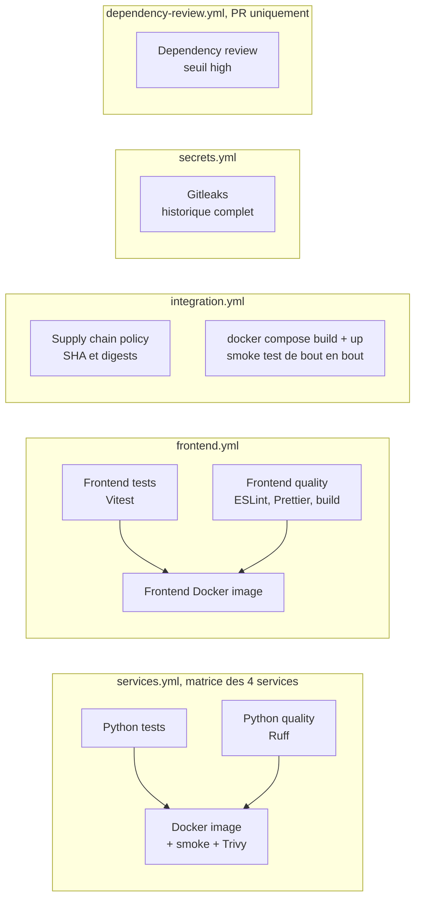
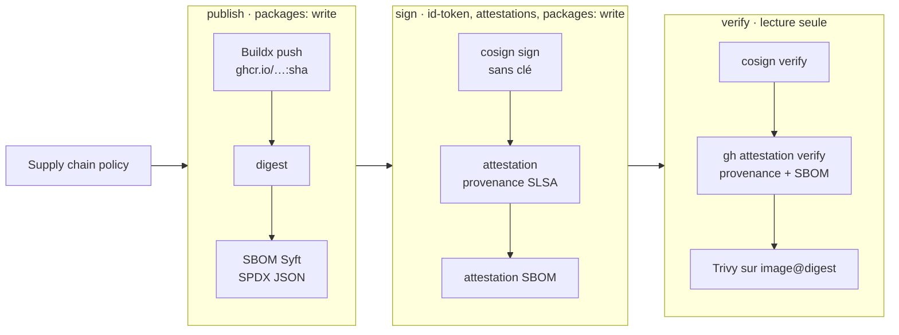
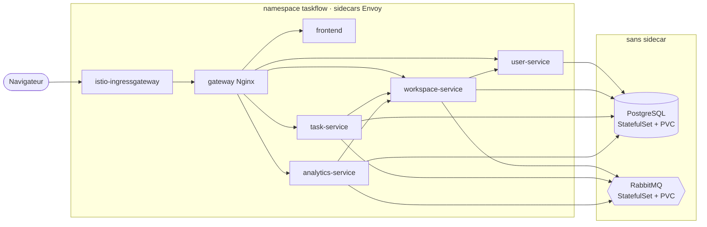

# TaskFlow

TaskFlow est une application de gestion de tâches collaborative, dans l'esprit de Trello.
Elle est construite en **microservices** : Angular 22 pour le front, FastAPI, Pydantic et
Tortoise ORM pour les services, PostgreSQL et RabbitMQ pour les données et les
événements, Docker pour le déploiement.

> Projet du cours *Intégration Cloud* (EFREI, S9). La partie DevOps s'inspire des TP
> [01 « une CI observable et bloquante »](https://github.com/charroux/rental/blob/main/course/labs/tp01.qmd)
> et [02 « produire et vérifier les preuves d'une image »](https://github.com/charroux/rental/blob/main/course/labs/tp02.qmd),
> le déploiement Kubernetes et Istio du TP [servicemesh](https://github.com/charroux/servicemesh).

---

## Sommaire

1. [Architecture](#architecture)
2. [Microservices](#microservices)
3. [Démarrage rapide](#démarrage-rapide)
4. [Images Docker](#images-docker)
5. [Intégration continue](#intégration-continue)
6. [Chaîne d'approvisionnement logicielle](#chaîne-dapprovisionnement-logicielle)
7. [Développement local](#développement-local)
8. [Structure du dépôt](#structure-du-dépôt)
9. [Déploiement Kubernetes et Istio](#déploiement-kubernetes-et-istio)
10. [Pistes d'évolution](#pistes-dévolution)

---

## Architecture



### Principes

| Sujet | Choix |
|---|---|
| **Point d'entrée unique** | Un gateway Nginx route `/api/<domaine>` vers le bon service et `/` vers le SPA Angular. Seul le port **8080** est exposé. |
| **Authentification** | UserService émet un **JWT** (HS256) contenant `sub`, `email` et `name`. Chaque service vérifie la signature avec un **secret partagé**, sans appeler UserService. |
| **Données** | Une instance PostgreSQL, **une base par service** (*database per service*). Aucune clé étrangère entre services : on ne stocke que des identifiants. Les schémas sont créés au démarrage par Tortoise (`generate_schemas`). |
| **Communication synchrone** | REST avec `httpx`. Le JWT de l'utilisateur est **transmis** à l'appel, et le service appelé applique ses propres règles d'accès. |
| **Communication asynchrone** | RabbitMQ, exchange `topic` durable `taskflow.events`, messages persistants. Une panne du broker ne fait pas échouer la requête HTTP : l'erreur est journalisée. |
| **Lecture analytique** | AnalyticsService construit sa propre **projection**, dans un style CQRS, à partir des événements. Il ne lit jamais la base de TaskService. |

### Flux d'événements



| Événement | Publié par | Consommé par | Effet |
|---|---|---|---|
| `workspace.created` / `updated` / `member_added` / `member_removed` | WorkspaceService | AnalyticsService | Journal d'activité |
| `workspace.deleted` | WorkspaceService | TaskService, AnalyticsService | Suppression des tâches et des statistiques de l'espace |
| `task.created` / `task.updated` | TaskService | AnalyticsService | Mise à jour de la projection |
| `task.deleted` | TaskService | AnalyticsService | Retrait de la projection |

---

## Microservices

Chaque service suit la même organisation : `app/main.py`, `config.py`, `models.py`
(Tortoise), `schemas.py` (Pydantic), `routers.py` et `security.py` (JWT). La
documentation OpenAPI est disponible via le gateway, à l'adresse `/api/<domaine>/docs`.

### UserService · [`services/user-service`](services/user-service)

| Méthode | Route | Description |
|---|---|---|
| POST | `/api/auth/register` | Inscription (mot de passe haché en PBKDF2-SHA256) |
| POST | `/api/auth/login` | Connexion, renvoie un JWT |
| GET / PATCH | `/api/users/me` | Profil de l'utilisateur connecté |
| GET | `/api/users/lookup?email=` | Recherche par email (utilisée par WorkspaceService) |
| GET | `/api/users/{id}` | Détail d'un utilisateur |

Docs : http://localhost:8080/api/users/docs

### WorkspaceService · [`services/workspace-service`](services/workspace-service)

Gère les espaces de travail et leurs membres. Trois rôles existent : `owner`, `admin` et `member`.

| Méthode | Route | Rôle requis |
|---|---|---|
| POST / GET | `/api/workspaces` | Être connecté (le créateur devient `owner`) |
| GET | `/api/workspaces/{id}` | Membre |
| PATCH | `/api/workspaces/{id}` | `owner` ou `admin` |
| DELETE | `/api/workspaces/{id}` | `owner` (publie `workspace.deleted`) |
| GET | `/api/workspaces/{id}/members` | Membre |
| POST | `/api/workspaces/{id}/members` | `owner` ou `admin` (appelle UserService en REST) |
| GET | `/api/workspaces/{id}/members/{userId}` | Membre (contrôle utilisé par les autres services) |
| DELETE | `/api/workspaces/{id}/members/{userId}` | `owner` ou `admin`. Un membre peut aussi se retirer lui-même. |

Un utilisateur qui n'est pas membre reçoit une **404**, pas une 403, pour qu'il ne puisse
pas deviner quels identifiants d'espace existent.

### TaskService · [`services/task-service`](services/task-service)

Une tâche a les champs suivants : `title`, `description`, `status` (`todo`,
`in_progress` ou `done`), `priority` (`low`, `medium` ou `high`), `assignee_id`,
`due_date` et `completed_at`, ce dernier étant renseigné automatiquement.

| Méthode | Route | Description |
|---|---|---|
| POST | `/api/tasks` | Création. L'auteur et la personne assignée doivent être membres de l'espace. |
| GET | `/api/tasks?workspace_id=&status=&priority=&assignee_id=` | Liste filtrée |
| GET | `/api/tasks/mine` | Tâches assignées à l'utilisateur connecté, tous espaces confondus |
| GET / PATCH / DELETE | `/api/tasks/{id}` | Mise à jour partielle : envoyer `null` vide le champ |

### AnalyticsService · [`services/analytics-service`](services/analytics-service)

| Méthode | Route | Description |
|---|---|---|
| GET | `/api/analytics/workspaces/{id}` | Total, répartition par statut et par priorité, taux de complétion, retards, tâches terminées sur 7 jours, charge par personne, activité récente |
| GET | `/api/analytics/me` | Statistiques personnelles |

### Frontend · [`frontend`](frontend)

Angular 22 (composants standalone, signals, zoneless, nouveau control flow) avec
Angular Material 3. Il comprend :

- la connexion et l'inscription ;
- la liste des espaces ;
- un **tableau kanban** avec glisser-déposer (CDK) ;
- la gestion des membres ;
- un onglet de statistiques ;
- une page « Mes tâches ».

Le JWT est ajouté automatiquement par un intercepteur, qui déconnecte l'utilisateur en
cas de réponse 401.

---

## Démarrage rapide

Il faut **Docker Desktop**, et c'est tout : aucun Node.js ni Python n'est nécessaire pour lancer l'application.

```bash
cp .env.example .env              # facultatif : des valeurs par défaut existent
docker compose up -d --build --wait
```

| URL | Contenu |
|---|---|
| http://localhost:8080 | Application TaskFlow |
| http://localhost:8080/api/tasks/docs | Swagger d'un service (même chemin pour `users`, `workspaces` et `analytics`) |
| http://localhost:15672 | Console RabbitMQ (`taskflow` / `taskflow`) |

Pour vérifier le fonctionnement de bout en bout, puis arrêter la stack :

```bash
python scripts/taskflow.py smoke   # scénario complet via le gateway
docker compose down                # ajouter -v pour effacer les données
```

Le smoke test parcourt tout le scénario :

1. inscription et connexion ;
2. création d'un espace ;
3. ajout d'un membre (REST de WorkspaceService vers UserService) ;
4. création d'une tâche (REST de TaskService vers WorkspaceService) ;
5. passage de la tâche à `done` ;
6. statistiques mises à jour via RabbitMQ ;
7. suppression de l'espace, avec purge des tâches via RabbitMQ.

---

## Images Docker

Le projet produit **6 images**, toutes construites par `docker compose build` et par la CI.

| Image | Base | Taille | Particularités |
|---|---|---|---|
| `taskflow/user-service` | `python:3.12-slim` | ~286 Mo | multi-stage (venv), utilisateur non-root, `HEALTHCHECK` |
| `taskflow/workspace-service` | `python:3.12-slim` | ~294 Mo | idem |
| `taskflow/task-service` | `python:3.12-slim` | ~294 Mo | idem |
| `taskflow/analytics-service` | `python:3.12-slim` | ~294 Mo | idem |
| `taskflow/frontend` | `node:24-alpine` pour le build, `nginx-unprivileged` à l'exécution | ~83 Mo | build Angular de production, fallback SPA, cache long sur les fichiers hashés |
| `taskflow/gateway` | `nginx-unprivileged:1.29-alpine` | ~82 Mo | reverse proxy, en-tête `X-Request-ID` |

Bonnes pratiques appliquées :

- **Images de base immuables** : chaque `FROM` garde son tag lisible et ajoute un digest
  `@sha256:…`. Dependabot propose les mises à jour par pull request.
- **Builds multi-stage** : les outils de build ne se retrouvent pas dans l'image finale.
- **Exécution non-root** : utilisateur `app` pour les images Python, images Nginx *unprivileged* écoutant sur le port 8080.
- **Cache de couches** : les dépendances (`requirements.txt`, `package-lock.json`) sont copiées avant le code source.
- **Contexte minimal** : un `.dockerignore` par image (sans tests, caches ni `node_modules`).
- **Supervision** : `HEALTHCHECK` dans chaque image, et `depends_on: condition: service_healthy` dans Compose.
- **Configuration** : uniquement par variables d'environnement (12-factor). Aucun secret n'est inclus dans les images.
- **Versionnement** : la variable `TAG` fixe le tag des images (`TAG=1.0.0 docker compose build`).

---

## Intégration continue

Six workflows GitHub Actions, dans [`.github/workflows`](.github/workflows), appliquent
les principes des TP 01 et 02. Sur une pull request, les images sont **construites mais
jamais publiées**. Seul le workflow `Supply chain`, sur `main`, publie dans GHCR (voir la
[section suivante](#chaîne-dapprovisionnement-logicielle)).



| Exigence du TP | Mise en œuvre |
|---|---|
| Tests et qualité séparés | Des jobs `tests` et `quality` distincts pour chaque service et pour le front |
| Graphe de dépendances | Le job `image` dépend (`needs`) de `tests` et de `quality` |
| Rapports exploitables même en cas d'échec | JUnit (pytest, Vitest, Ruff), couverture et scan Trivy publiés avec `upload-artifact`, `if: always()` et `retention-days: 7` |
| Annotations | `ruff check --output-format=github` |
| Sécurité de la CI | `permissions: contents: read` par défaut, **toutes** les actions épinglées par SHA complet, aucune publication d'image depuis une PR |
| Coût maîtrisé | `timeout-minutes` sur chaque job, cache pip, npm et Docker (`type=gha`), `concurrency` avec `cancel-in-progress` |
| Détection de secrets | Gitleaks sur l'historique complet (`fetch-depth: 0`), avec une allowlist documentée dans [`.gitleaks.toml`](.gitleaks.toml) |
| Reproduction en local | `python scripts/taskflow.py verify` |

Les workflows n'ont **pas de filtre `paths`**. Un tel filtre empêcherait les checks
obligatoires de s'exécuter sur certaines PR, qui resteraient alors bloquées en attente.

**Checks à rendre obligatoires** sur `main` une fois le dépôt publié :

- `Python tests (*)`, `Python quality (*)` et `Docker image (*)`
- `Frontend tests`, `Frontend quality` et `Frontend Docker image`
- `Docker Compose stack` et `Supply chain policy`
- `Secret detection`
- `Dependency review`

---

## Chaîne d'approvisionnement logicielle

Ce volet applique le TP 02. Un tag comme `latest` ne dit ni ce qui sera déployé, ni qui
l'a produit. Chaque image publiée est donc identifiée par son **digest** et accompagnée
de preuves vérifiables.

### Références immuables

| Élément | Contrôle |
|---|---|
| Actions GitHub | Épinglées par SHA de commit complet, version lisible en commentaire : `actions/checkout@3d3c42e… # v7.0.1` |
| Images de base | Tag et digest : `FROM python:3.12-slim@sha256:…` (Dockerfiles, Compose, manifestes Kubernetes) |
| Mises à jour | [Dependabot](.github/dependabot.yml) ouvre des PR hebdomadaires pour les écosystèmes `github-actions` et `docker` |
| Politique | `python scripts/taskflow.py supply-chain-policy` échoue sur une action sans SHA ou une image sans digest. Il s'exécute dans `verify` et sur chaque PR |

### Modélisation des risques

| Élément | Scénario de substitution | Impact | Contrôle qui réduit le risque |
|---|---|---|---|
| Action GitHub | Le tag majeur `v7` est déplacé vers un commit malveillant | Code arbitraire dans la CI, avec ses jetons | Épinglage par SHA, politique locale et sur PR, Dependabot pour les mises à jour volontaires |
| Image de base | Le manifeste derrière `python:3.12-slim` est remplacé | Contenu inconnu dans toutes les images | Digest dans chaque `FROM`, Trivy sur l'image finale |
| Dépendance applicative | Une PR ajoute une bibliothèque vulnérable | Vulnérabilité livrée en production | Revue des dépendances (seuil `high`), versions figées dans `requirements.txt` et `package-lock.json` |
| Image produite | `latest` est déplacé après le scan, ou une image est poussée hors CI | On déploie autre chose que ce qui a été testé | Tout se fait sur `image@digest` : signature Cosign, attestations, vérification, puis Trivy |
| Identité du producteur | Une image est signée avec une clé volée | Fausse confiance dans l'origine | Signature sans clé : l'identité est celle du workflow sur `main`, certifiée par l'OIDC de GitHub |

### Revue des dépendances ou Trivy ?

Les deux contrôles sont complémentaires. La **revue des dépendances**
([dependency-review.yml](.github/workflows/dependency-review.yml)) compare les manifestes
et lock files **avant le merge**. Elle bloque une PR qui *introduit* une dépendance
vulnérable, avant qu'elle n'entre dans `main`. **Trivy** analyse le **contenu final de
l'image** : paquets du système de base, bibliothèques effectivement installées, y compris
les vulnérabilités publiées après le merge. Le premier contrôle porte sur le changement
proposé, le second sur l'artefact livré.

### Pipeline de publication

[supply-chain.yml](.github/workflows/supply-chain.yml) s'exécute uniquement sur `main`,
pour les six images. Chaque job reçoit seulement les permissions dont il a besoin.



Le SBOM, le digest, la sortie de `cosign verify`, la provenance et le rapport Trivy sont
conservés 7 jours comme artefacts de l'exécution (`evidence-*`, `verification-*`).

Vérifier une image publiée depuis un poste (avec [Cosign](https://docs.sigstore.dev/cosign/system_config/installation/)
et la CLI `gh`) :

```bash
IMAGE=ghcr.io/haribo015/taskflow/task-service@sha256:<digest>
cosign verify "$IMAGE" \
  --certificate-identity "https://github.com/haribo015/taskFlow/.github/workflows/supply-chain.yml@refs/heads/main" \
  --certificate-oidc-issuer https://token.actions.githubusercontent.com
gh attestation verify "oci://$IMAGE" --repo haribo015/taskFlow
gh attestation verify "oci://$IMAGE" --repo haribo015/taskFlow --predicate-type https://spdx.dev/Document/v2.3
```

À activer une fois dans *Settings > Security* du dépôt : le **graphe de dépendances** et
les **alertes Dependabot**.

---

## Développement local

```bash
python -m venv .venv
.venv\Scripts\activate                  # Windows (source .venv/bin/activate sous Linux/macOS)
pip install -r services/task-service/requirements-dev.txt   # mêmes versions pour tous les services

python scripts/taskflow.py verify       # politique, tests puis qualité ; s'arrête au premier échec (code 1)
python scripts/taskflow.py supply-chain-policy   # actions épinglées par SHA, images par digest
python scripts/taskflow.py test         # pytest pour les 4 services, puis Vitest
python scripts/taskflow.py lint         # Ruff, puis ESLint et Prettier
python scripts/taskflow.py images       # construit les 6 images
python scripts/taskflow.py up | down | smoke
python scripts/taskflow.py load 300 20  # charge concurrente, affiche les codes HTTP reçus
```

- Les tests Python utilisent **SQLite en mémoire**. Les appels REST et RabbitMQ sont
  remplacés par des faux via `dependency_overrides`, ce qui évite toute infrastructure.
- Les commandes du **front** s'exécutent dans un conteneur `node:24-alpine`, car
  Angular 22 demande Node ≥ 22.22. Il n'y a donc rien à installer.
- Pour développer le front en *hot reload* :
  1. démarrez la stack ;
  2. dans `frontend/`, lancez `npm start` (avec Node 24) ;
  3. le fichier `proxy.conf.json` redirige `/api` vers le gateway.

### Variables d'environnement

| Variable | Services | Défaut |
|---|---|---|
| `DATABASE_URL` | tous | `sqlite://:memory:` (Compose : `postgres://…/<service>_db`) |
| `JWT_SECRET` | tous (32 caractères minimum) | valeur de développement |
| `RABBITMQ_URL` | workspace, task, analytics | non défini, ce qui désactive les événements |
| `USER_SERVICE_URL` | workspace | `http://user-service:8000` |
| `WORKSPACE_SERVICE_URL` | task, analytics | `http://workspace-service:8000` |

---

## Structure du dépôt

```
taskFlow/
├── services/
│   ├── user-service/          # app/, tests/, Dockerfile, requirements*.txt, pyproject.toml
│   ├── workspace-service/
│   ├── task-service/
│   └── analytics-service/
├── frontend/                  # Angular 22 + Material, Dockerfile, nginx.conf
├── gateway/                   # Nginx API gateway, Dockerfile
├── infra/postgres/            # script de création des bases
├── k8s/
│   ├── base/                  # Kustomize : ConfigMap, PostgreSQL, RabbitMQ, services, front, gateway
│   └── istio/                 # Gateway, mTLS, résilience, fautes, circuit breaker, traçage
├── scripts/
│   ├── taskflow.py            # verify / supply-chain-policy / images / up / down / smoke / load
│   ├── k8s.sh                 # déploiement Minikube + Istio + addons, port-forwards
│   └── k8s_secrets.py         # Secret Kubernetes généré localement
├── .github/
│   ├── workflows/             # services, frontend, integration, secrets, dependency-review, supply-chain
│   └── dependabot.yml
├── docker-compose.yml
└── .env.example
```

---

## Déploiement Kubernetes et Istio

Le dossier [`k8s/`](k8s/) transpose la stack Compose dans un cluster **Minikube**, avec le
service mesh **Istio** et ses outils d'observation, en suivant le TP
[servicemesh](https://github.com/charroux/servicemesh). Le guide complet, avec les
prérequis, chaque commande, les démonstrations et le dépannage, est dans
**[README.test_deploy.md](README.test_deploy.md)**.

```bash
bash scripts/k8s.sh up          # cluster, Istio, images, TaskFlow, Kiali/Prometheus/Grafana/Jaeger
bash scripts/k8s.sh forward     # http://localhost:8080 via l'ingress Istio
bash scripts/k8s.sh kiali       # http://localhost:20001 (dans une autre fenêtre)
python scripts/taskflow.py smoke
```



| Objet | Rôle |
|---|---|
| `Namespace` avec `istio-injection: enabled` | Un proxy Envoy est injecté dans chaque pod applicatif |
| `Deployment`, `Service`, sondes `startup`/`readiness`/`liveness` | Six applications, images chargées dans Minikube (`imagePullPolicy: Never`) |
| `StatefulSet` et volumes persistants | PostgreSQL et RabbitMQ, sans sidecar |
| `ConfigMap`, `Secret` | Configuration, et identifiants générés par `scripts/k8s_secrets.py` (jamais commités) |
| `Gateway`, `VirtualService` | Entrée Istio vers le gateway Nginx |
| [`resilience.yaml`](k8s/istio/resilience.yaml) | Timeout et retries vers WorkspaceService |
| [`mtls.yaml`](k8s/istio/mtls.yaml) | `PeerAuthentication` en mTLS strict |
| [`fault-injection.yaml`](k8s/istio/fault-injection.yaml) | Démo : erreurs 503 et délais sur AnalyticsService |
| [`circuit-breaker.yaml`](k8s/istio/circuit-breaker.yaml) | Démo : `DestinationRule` avec limite de connexions et éjection |
| [`tracing.yaml`](k8s/istio/tracing.yaml) | `Telemetry` : envoi des traces vers Jaeger |

Le gateway Nginx transmet le nom du service cible dans l'en-tête `Host`. Les sidecars
routent ainsi chaque appel vers le bon `Service` Kubernetes : Kiali affiche les vrais arcs
entre services, et le mTLS s'applique aussi à ces appels.

## Pistes d'évolution

- **Déploiement hors Minikube** : déployer les images signées de GHCR par digest,
  remplacer `imagePullPolicy: Never` et gérer les secrets et volumes avec les services
  du fournisseur cloud.
- **Admission Kubernetes** : refuser toute image non signée par le workflow (Sigstore
  policy-controller ou Kyverno).
- **Verrouillage par hash** des dépendances Python (`pip install --require-hashes`).
- **Migrations** : remplacer `generate_schemas` par Aerich.
- **Bibliothèque partagée** : `security.py` et `messaging.py` sont copiés à l'identique
  dans chaque service pour garder les images indépendantes. On pourrait en faire un
  paquet interne.
- **Fiabilité** : un *outbox pattern* garantirait la publication des événements.
